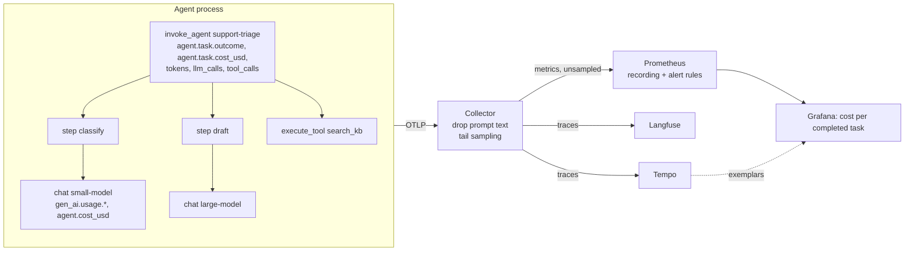

# agent-tracing-otel

[](https://github.com/darshansatpathy/agent-tracing-otel/actions/workflows/ci.yml)
[](https://github.com/darshansatpathy/agent-tracing-otel/actions/workflows/codeql.yml)


OpenTelemetry tracing for agent runs, built around one number: **what a completed task costs**. Spans follow the OpenTelemetry GenAI semantic conventions, so they work in Langfuse, Tempo and any OTLP backend; metrics feed Prometheus rules and a Grafana dashboard.

Cost per call and cost per token hide the expensive part of running agents: the tasks that fail, retry or get escalated still spend. In the simulated workload in [`docs/cost-report.md`](docs/cost-report.md) (5,000 tasks):

| | |
|---|---|
| Cost per task attempted | $0.0323 |
| **Cost per completed task** | **$0.0348** |
| Spend on tasks that did not complete | 14% |
| The research agent: share of tasks / share of spend | 15% / **61%** |
| Cost per completed task: research vs triage | $0.1584 vs $0.0156 |

## Instrumenting an agent

```python
import agenttrace
from agenttrace import task, llm, tool, step

agenttrace.configure(prices="prices.yaml")  # plus your usual OpenTelemetry providers and OTLP exporter

with task("support-triage", task_id=ticket.id, conversation_id=conv.id) as t:
    with step("draft"), llm("large-model", temperature=0.2) as call:
        resp = client.chat(...)
        call.usage(
            input_tokens=resp.usage.prompt_tokens, output_tokens=resp.usage.completion_tokens, cache_read_tokens=resp.usage.cached_tokens
        )
        call.response(model=resp.model, finish_reasons=[resp.finish_reason])
    with tool("search_kb", call_id=tc.id):
        hits = kb.search(query)
    t.outcome("success")  # or "failure", "escalated", "abandoned"; an exception means failure
```

For OpenAI-compatible endpoints, `agenttrace.integrations.openai_compat.chat(client, model, messages)` does the span, usage, cache and cost in one call.

## What gets recorded



| Signal | Name | Notes |
|---|---|---|
| Task span | `invoke_agent {agent}` | `gen_ai.agent.name`, `agent.task.outcome`, `agent.task.cost_usd`, `agent.task.input_tokens`, `agent.task.llm_calls`, `agent.task.tool_calls` |
| Model span | `chat {model}` | `gen_ai.request.model`, `gen_ai.provider.name`, `gen_ai.usage.input_tokens`, `gen_ai.usage.output_tokens`, `gen_ai.usage.cache_read.input_tokens`, `gen_ai.response.finish_reasons`, `agent.cost_usd` |
| Tool span | `execute_tool {tool}` | `gen_ai.tool.name`, `gen_ai.tool.call.id`, `error.type` |
| Metrics | `gen_ai.client.token.usage`, `gen_ai.client.operation.duration` | GenAI conventions |
| | `gen_ai.client.cost`, `gen_ai.client.unpriced_tokens` | spend, and tokens on models missing from the price table |
| | `agent.tasks`, `agent.task.cost`, `agent.task.duration`, `agent.tool.duration` | by agent and outcome |

Cost is computed from the usage the provider returned and a dated price table ([`prices.yaml`](prices.yaml)): cached input at the cache rate, the price in effect on the day, unknown models counted as unpriced (and alerted on), never as free. Prompt and completion text is not recorded unless you turn it on, and the Collector strips it anyway.

## Running the stack

```bash
pip install -e ".[otlp]"
docker compose up -d                                         # Collector, Tempo, Prometheus, Grafana on :3000
agenttrace simulate --tasks 2000 --otlp http://localhost:4318
```

Open the **Agents: cost per completed task** dashboard. To also send traces to Langfuse, set `LANGFUSE_OTLP_ENDPOINT` and `LANGFUSE_AUTH` and run the Collector with the `deploy/collector/langfuse.yaml` overlay (see `docker-compose.yml`).

`agenttrace report spans.jsonl` produces the cost report from spans: from `simulate --jsonl`, or from the Collector's file exporter in production.

## Alerts

[`deploy/prometheus/rules.yaml`](deploy/prometheus/rules.yaml), each tested with `promtool test rules`:

| Alert | When |
|---|---|
| `AgentCostPerCompletedTaskRising` | the last hour is 50% above the 7-day level for 30 minutes |
| `AgentSuccessRatioLow` | an agent completes under 85% of tasks for 15 minutes |
| `ModelCallErrorsHigh` | over 5% of a model's calls fail for 10 minutes |
| `UnpricedModelInUse` | tokens are being spent on a model with no price |

## Repository layout

```
src/agenttrace/   tracing.py (task, llm, tool, step), pricing.py, analysis.py, export.py, simulate.py, cli.py,
                  integrations/openai_compat.py
deploy/           collector/ (pipeline + Langfuse overlay), prometheus/ (rules + tests), grafana/ (generator,
                  dashboard, provisioning), tempo/
docs/             cost-report.md, ADRs
```

## Design decisions

[ADR 1](docs/adr/0001-genai-conventions.md) GenAI conventions · [ADR 2](docs/adr/0002-cost-per-completed-task.md) cost per completed task · [ADR 3](docs/adr/0003-metrics-are-not-sampled.md) metrics are not sampled · [ADR 4](docs/adr/0004-content-off-by-default.md) content off by default

## License

MIT
